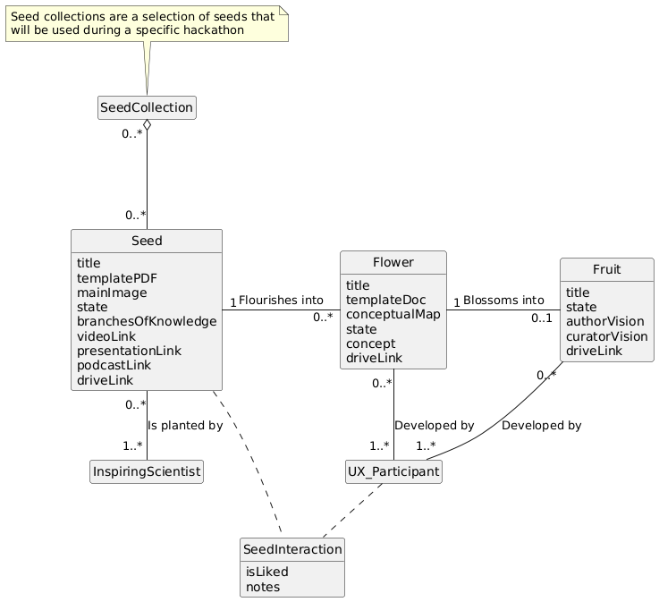
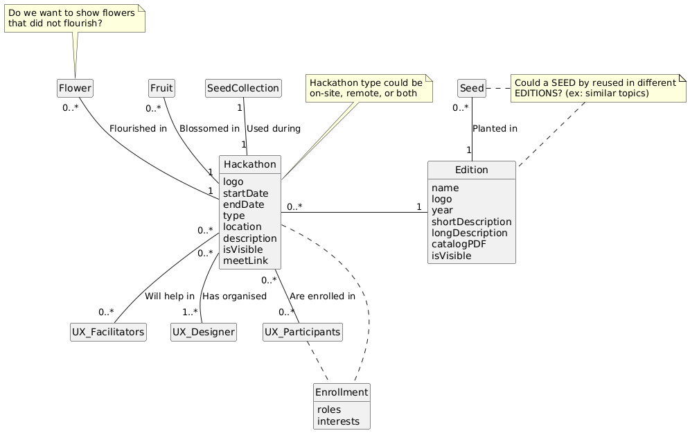
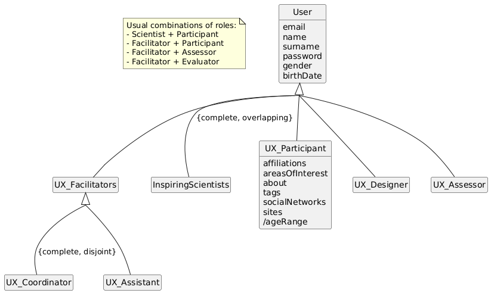
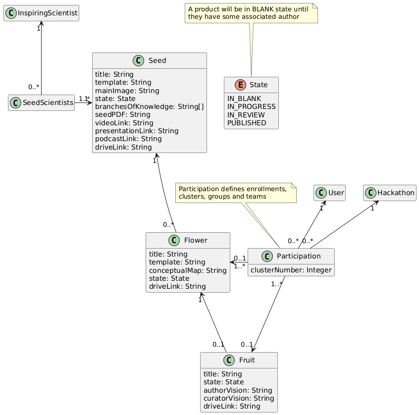
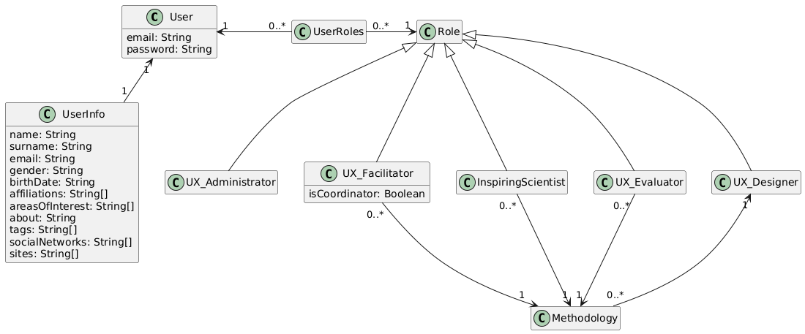
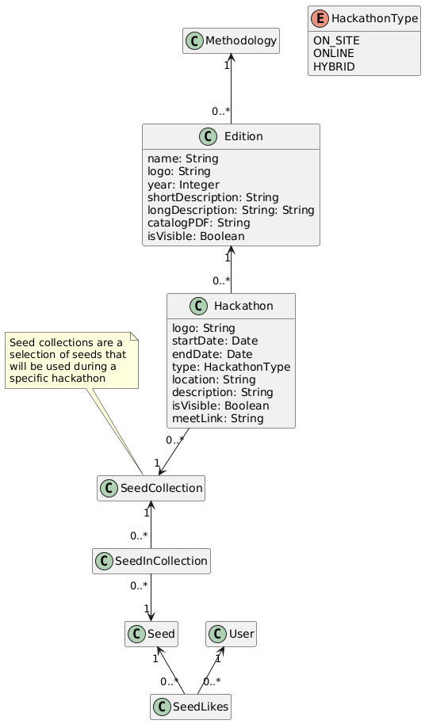

# Diagrams

Conceptual and domain diagrams of AppSciArt. Each PNG is rendered from the PlantUML source (`.iuml`) next to it.

## Conceptual

| Diagram | Source |
|---|---|
| Items | `conceptual/AppSciArt_items.iuml` |
| Process | `conceptual/AppSciArt_process.iuml` |
| Users | `conceptual/AppSciArt_users.iuml` |

### Items

### Process

### Users

## Domain

| Diagram | Source |
|---|---|
| Items | `domain/AppSciArt_items.iuml` |
| Roles | `domain/AppSciArt_roles.iuml` |
| Structure | `domain/AppSciArt_structure.iuml` |

### Items

### Roles

### Structure

